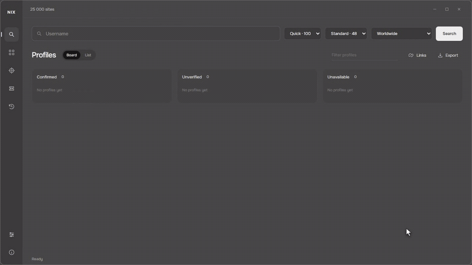

# NIX

Desktop search for public profiles by username. Results appear as sites respond. NIX also collects new sites from public directories and links between servers.



[Download for Windows](https://github.com/hexmisery/NIX/releases/latest) · [Watch the full demo](https://github.com/hexmisery/NIX/releases/latest/download/NIX-demo.mp4)

## What it does

- Search across 25,000 profile URL templates covering 23,666 hostnames in the bundled snapshot.
- Show confirmed, unverified and unavailable results, with a reason for each result.
- Filter by status, source and region. A region filter uses domain and language metadata; it cannot establish a person's location.
- Discover public sites, save progress and continue until stopped.
- Add your own site rules and transfer collected catalogs between installations.
- Import and check HTTP/SOCKS proxies. Choose direct access or one selected working proxy.
- Export results as JSON, CSV or HTML.
- Switch between English and Russian and adjust window transparency.

The catalog combines Maigret, Sherlock, WhatsMyName, NExfil, Social Analyzer, public forum directories, collected server metadata and FediDB. Blackbird uses WhatsMyName; a separate Blackbird executable is not bundled. Adult sources are available through the settings and are off by default.

## Windows

Download `NIX.exe` from Releases and run it. This is a standalone build; Python is not required. Microsoft Edge WebView2 Runtime is required. The executable is unsigned. SHA-256 checksums are included with each release.

Enter a username, choose a search size and press **Search**. **Quick** checks the first 100 sources; **Full catalog** checks all eligible sources. Higher connection counts help when requests are waiting on the network. They do not bypass website limits.

Open **Discovery**, select a region and press **Start** to collect sites. **Until stopped** repeats collection cycles and saves progress. Use **Sites** to manage rules and import or export catalogs.

Search history, collected sites, preferences and proxies are stored separately from the executable. Replacing the executable keeps that data. Share the catalog export when transferring sites; it excludes search history and proxy credentials.

## macOS

Download the archive for your Mac:

- [Apple Silicon: M1, M2, M3, M4 and later](https://github.com/hexmisery/NIX/releases/latest/download/NIX-darwin-arm64.tar.gz)
- [Intel](https://github.com/hexmisery/NIX/releases/latest/download/NIX-darwin-x64.tar.gz)

Extract the archive and move `NIX.app` to Applications. Keep the application bundle intact. The app is not notarized; if macOS blocks the download, the source installation below is an alternative.

To run from source:

Install Python 3.11 or newer from [python.org](https://www.python.org/downloads/macos/), then:

```sh
git clone https://github.com/hexmisery/NIX.git
cd NIX
python3 -m venv .venv
source .venv/bin/activate
python -m pip install -r requirements.txt
python run.py
```

macOS uses its native WebKit backend. Window effects can differ from Windows.

## Linux

The supported build target is Ubuntu 24.04 x64 with GTK and WebKitGTK. Other distributions may need different system packages.

[Download Linux x64](https://github.com/hexmisery/NIX/releases/latest/download/NIX-linux-x64.tar.gz), then:

```sh
sudo apt update
sudo apt install gir1.2-gtk-3.0 gir1.2-webkit2-4.1
tar -xzf NIX-linux-x64.tar.gz
./NIX/NIX
```

Keep the extracted `NIX` folder together. Older distributions with an older glibc may not run this build.

To run from source on Ubuntu 24.04:

```sh
sudo apt update
sudo apt install git python3-venv python3-dev build-essential pkg-config libgirepository1.0-dev libcairo2-dev gir1.2-gtk-3.0 gir1.2-webkit2-4.1
git clone https://github.com/hexmisery/NIX.git
cd NIX
python3 -m venv .venv
source .venv/bin/activate
python -m pip install -r requirements.txt
python -m pip install PyGObject==3.48.2 pycairo
python run.py
```

Linux uses an opaque window. Desktop transparency is currently implemented for Windows and macOS.

## Run from source on Windows

Python 3.11 or newer:

```sh
python -m venv .venv
```

Activate the environment with `.venv\Scripts\activate` on Windows or `source .venv/bin/activate` on macOS/Linux, then:

```sh
python -m pip install -r requirements.txt
python run.py
```

Windows uses WebView2. See [pywebview's installation instructions](https://pywebview.flowrl.com/guide/installation.html) for backend details.

A limited command-line search:

```sh
python run.py --cli admin --full --region all --limit 20 --output results.json
```

No API keys or `.env` file are required. `NICKATLAS_DATA_DIR` optionally changes the local data directory.

## Checks and build

```sh
python -m pip install -r requirements-dev.txt
python -m pytest tests -q
python build.py
```

The build writes the desktop application to `dist/`. Keep the complete output folder together. On Windows, `python build.py --onefile` creates a standalone executable in `standalone/`.

To check whether catalog sites respond:

```sh
python tools/check_catalog.py --output catalog-check
```

The check saves a resumable JSONL report and a summary. It distinguishes responding, redirected, restricted and unreachable sites. It does not verify profile detection or account ownership.

[October 23 availability report](docs/catalog-check.md): 20,983 fixed origins responded on the same hostname. This is a homepage availability result, not a count of verified profile detectors.

Platform builds are checked in [GitHub Actions](https://github.com/hexmisery/NIX/actions/workflows/build.yml): unit tests, the native interface and Python bridge from source, and `--help` in the frozen application. These checks do not cover every feature in the packaged macOS/Linux GUI.

## Limits

A matching username does not prove that accounts belong to the same person. A **Confirmed** result means the site's response matched the available identity checks. It does not verify ownership. **Unverified** results need manual review. Login walls, CAPTCHAs, rate limits, changed page layouts and offline sites can prevent a result.

The bundled count is a count of URL templates, not a count of independent platforms or confirmed accounts. Federation servers contribute many entries. FediDB's snapshot is dated October 18, 2026; directory entries were normalized and deduplicated, not individually checked for every username. Discovery adds supported sites and cannot cover every website.

Use public pages within the sites' access rules. NIX does not bypass authentication or CAPTCHAs. Network requests are paced, private destination addresses are rejected, and blocked proxy requests do not silently fall back to a direct connection. Free proxies are third-party infrastructure; avoid sending credentials through them.

## License

NIX code is MIT licensed. Bundled datasets, fonts and libraries retain their own licenses; see [LICENSE.txt](LICENSE.txt) and [licenses/ATTRIBUTION.txt](licenses/ATTRIBUTION.txt). FediDB-derived data is CC BY 4.0. WhatsMyName is CC BY-SA 4.0. The Social Analyzer dataset retains AGPL-3.0 terms.

Author: [@hexm1sery](https://github.com/hexmisery).
